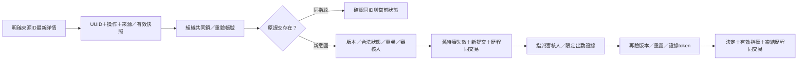
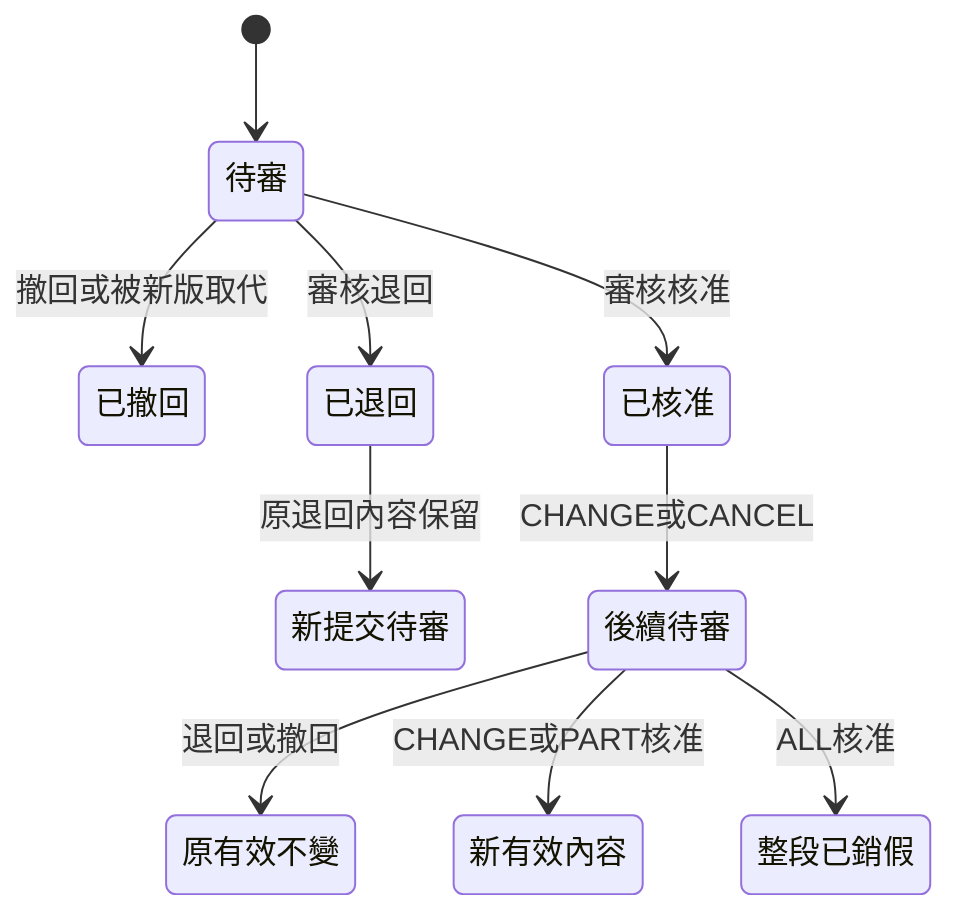

# T05.1 假單版本、變更與銷假

## 三分鐘摘要

一張假單的「提交內容」、「這次審核狀態」與「現在有效請假」分開保存。每次修改建立新的 leave_request ID；leave_document串起同一業務單，effective_request_id精確指定有效內容。原已核准09～17，變更09～14待審期間仍480分，核准才300分；退回／撤回都保留原有效。

整段銷假保存原正分鐘區間，核准後effective=null、canceled=true；部分銷假只縮短一側。歷史APPROVED不等於現在有效，不拿所有核准版本相加。沒有增加假別／額度／薪資／通用流程引擎。

## 資料流與狀態





「新提交待審」是新ID，並非把舊REJECTED改PENDING。

## 實作位置與方法

| 檔案（從repo根目錄）／方法 | 責任 |
|---|---|
| backend/src/main/java/com/renewflow/eip/leave/LeaveController.java / revisions | 解析DTO與呼叫Service，201新建／200重播 |
| 同目錄 LeaveRevisionService.java / submit | 共同鎖、去重、來源／有效快照、單一流程、正規化、重疊、重新解析審核人、原子替換 |
| LeaveRevisionService / prepareDecision、finishDecision | 核准前再次驗證，出勤token，條件切換有效內容與凍結DecisionContext |
| LeaveRequestService / approve、reject、withdraw | 既有入口／角色與範圍，呼叫版本保護、寫決定歷程 |
| LeaveDocumentRepository / activate | expected有效指標＋版本的條件UPDATE，成功+1 |
| LeaveRequestRepository / findOverlappingExcludingDocument | 目前有效＋PENDING預留，排除同業務單 |
| LeaveViews / detail、evidence | 原提交／原核准／目前有效／所有版本，先驗範圍才取出勤 |
| backend/src/main/java/com/renewflow/eip/attendance/AttendanceEvidenceRepository.java | 單一SELECT讀紀錄與原事件，無GPS、無寫入 |
| AttendanceEvidenceService / forAuthorizedLeave | 相關日DTO、capturedAt、內容token，取得時間不納入token |
| backend/src/main/resources/db/migration/V9__leave_revisions.sql | 複合FK、單一pending、不可改已提交內容、舊資料轉換 |
| frontend/src/leave/LeaveRevisionDialog.tsx / send | 每次GET明確來源，原快照送出／重試、未知鎖定／警告放棄 |
| frontend/src/leave/revisionOutcome.ts / checkRevisionResult、canRevise | 執行期核對UUID／動作／來源／正文，合法UI操作 |
| frontend/src/leave/LeaveDocumentSummary.tsx | 分開有效、原核准、新申请、差異、當前及歷程出勤 |

## 重要片段、鎖與交易

```java
lock.acquireFor(actor);
var prior = requests.findByEmployeeIdAndRequestId(actor.getEmployeeId(), body.requestId()).orElse(null);
if (prior != null) {
    if (!fingerprint.equals(prior.getFingerprint())) throw conflict(...);
    return result(true, prior);
}
```

先確認原提交再檢查現在審核人；否則晚到的確認會因設定變更失敗，誘使用戶開第二個流程。指紋包括操作、來源ID／版本、基礎有效ID／版本與正規化內容；同員工UUID是資料庫唯一鍵。原流程終態仍確認同ID。

```sql
update leave_document
set effective_request_id = ?, effective_version = effective_version + 1, canceled = ?
where id = ? and effective_version = ?
  and effective_request_id is not distinct from ?;
```

實際SQL見repository（參數顺序以原碼為準）。先組織交易級advisory lock，再查／寫員工與請假列；等待後重驗actor，不能拿Filter之前的舊角色。所有決定／有效切換／審核證據歴程在同一交易；任何故障整批回滾。組織鎖序列化跨列规則，索引與條件UPDATE是最後防線。全域鎖簡單而吞吐有限，目前沿用；沒有藉此全面重構分散鎖。

## 出勤證據與權限

本人、該流程指派審核人及既有ADMIN管理範圍才有詳情。新出勤讀取服務沒有HTTP入口，請假先驗證範圍，再只傳申請人與相關日期。當前紀錄含多組、補登／更正／作廢／未下班；原事件獨立ID與acceptedAt，後來更正不改原事件。無紀錄明示，打卡不自動證明工作或核准。

新版審核提交evidenceToken；CHANGE／CANCEL強制核對，內容改變409需刷新。新決定歷程freeze當時摘要、effective前後版本、capturedAt與previewVerified。CREATE／REVISE舊API允许省token，但previewVerified=false，不把決定當下取樣說成審核人看過。舊歷程無快照也不推斷為當日沒有打卡。

## 前端提交結果

POST成功狀態不是充分證據。JSON損壞、讀取失敗、缺欄位、UUID／操作／來源／內容錯配→unknown，保留原本文與UUID、鎖住來源與其他修改入口。重試403／5xx仍unknown，只有確認同提交或警告後明確放棄才解除。同步ref防連按，useLifetime防卸載回應，useLoad維持舊查詢淘汰。重新整理沒有持久草稿，先查實際紀錄；不跨帳號重播。

## 測試與取捨

真HTTP＋PostgreSQL驗證可觀察狀態與完整表快照；並行涵盖修改vs核准、同UUID、双核准、變更vs銷假、審核vs改派；强制advisory等待後停用actor必须401零寫入。Mockito在實際SQL／歴程寫入後抛錯，證明整體回滾。V8→V9用舊欄位投影逐表比對，不把新欄位算資料毁損。浏览器真POST僅破壞收到的成功Response，驗證unknown與重播；這是受控故障，不稱真實網路設備測試。最後結果與變異恢複證據見 [verification](../renewflow/t05-1/verification.md)。真人教材全部未執行。

採兩張表，讓歷史與有效內容可同時表达，付出查詢聯表與migration複雜度。只支援單段、單日、單侧銷假；沒有流程發布、職稱解析、代理／分支／拖拉設计器。頁面合計是本頁目前有效列，非假別額度或全日期總額。

## 面試重點與練習

能說明：為什么只改同一行version會丢提交內容；為什么歷史APPROVED不能等同有效；為什么UUID確認要先于當前业務檢查；為何共同鎖仍需條件SQL與FK；如何用真實寫後故障證明原子性；凍結歷程如何與當前證據區別。

練習（不附答案）：把單側銷假擴成取消中間而剩兩段時，列出資料模型、有效版本、重叠、冪等、審核證據與migration的必要變化，並提出三個會暴露錯誤設计的測試。
