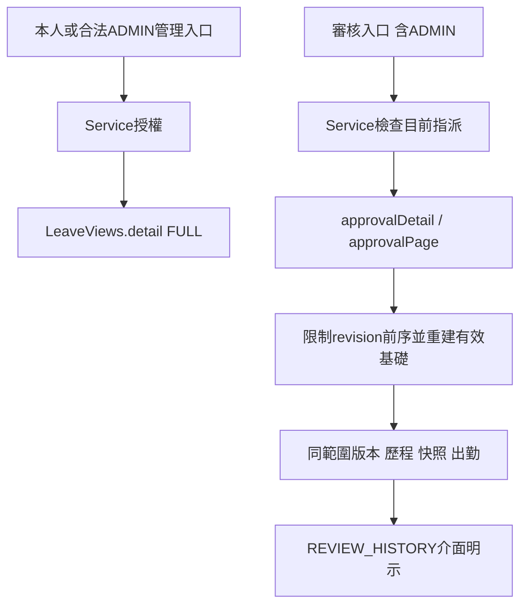
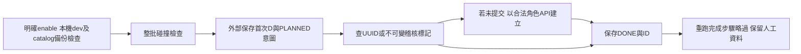

# T05.1 R1／R2 與客戶展示：學習交接

## 三分鐘理解

請假「提交」是某次送審內容；「業務單」包含提交歷史；「有效內容」才是目前占用時段。使用者有某次提交的審核權，並不等於有整張業務單後續提交的讀取權。R1 的錯誤是第一層 request 檢查通過，深層 document、歷程、快照及出勤卻用全局範圍組裝。

現在本人／ADMIN管理入口使用 FULL；審核入口一律 REVIEW_HISTORY，即使登入者是 ADMIN 也一樣。以所選提交的內容版本為邊界，只提供本次及必要前序。此歷史檢視的 effective 是重建的審核基礎，不能拿來聲稱全局目前仍有效；介面明示範圍。

R2 撤回只關閉待審流程。CREATE／REVISE 釋放待審預留；CHANGE／CANCEL保留原有效 ID、版本、日期與時間。後端原交易正確，修正文案即可。

展示初始化也是業務操作：用對應角色的 API 建立、送審、核准／退回；MANUAL歷史補登與CLOCK事件不同。首次 D、持久化意圖、穩定 UUID、完成 ID 與碰撞標記讓故障續跑可確認已提交，不能靠清庫重建。作者自測完成不代表第三方複審或 Max 真人驗收。

## 呼叫流程與契約



| 欄位 | FULL | REVIEW_HISTORY |
|---|---|---|
| document.viewMode／revision.viewMode | 完整管理／本人資料 | 明確受限範圍 |
| document.throughRevision | 已提供的最新內容版本 | 所選內容版本 |
| versions／pending／originalApproved | 整張業務單 | 僅可見前序集合 |
| effective／effectiveVersion／canceled | 真正目前狀態 | 該集合重建的基礎；不是時間點快照 |
| history | 同單完整歷程 | 只連到可見提交 |
| decisionRestricted | 通常false | 超範圍決定摘要被扣留；與舊紀錄未存摘要不同 |
| evidence | 所選、原核准及目前有效相關日 | 所選與可見前序相關日，不讀未來版本日期 |
| 清單effectiveTotalMinutes | 本頁目前有效合計 | null，表示未提供；不當成0 |

改派同一待審版本後，舊審核人GET及審核POST都404；不能靠前端隱藏確保安全。API不接受前端指定的viewMode。合法新審核人仍取得必要前序及自己的本次出勤依據。

## 程式導讀

- `backend/.../leave/LeaveRequestService.java`：`getApproval`／`listApprovals`／決定回應選擇審核組裝；本人及管理呼叫原完整組裝。
- `LeaveViews.java`：`visibleThrough`、`historicalDocument`、`approvalDetail`／`approvalPage`、`history`／`withinScope`與限定doc的`evidence`。`LeaveHistoryRepository.findDocumentHistoryThroughRevision`將歷程限制落在查詢層。
- `LeaveDtos.java`與`frontend/src/api/leave.ts`：新增範圍欄位與可空合計。`LeaveDocumentSummary`／`LeaveList`／`LeaveDetailDialog`：區別歷史有效基礎、完整目前有效、未提供摘要。
- `frontend/src/pages/LeavePage.tsx`的`WithdrawAction`：列申請ID／操作／日期時間、結案效果、原有效內容。
- `tools/seed-stmax-demo.mjs`：`guardLocalRuntime`、`initializeDemo`、`step`、`decision`、`acquireLock`；僅沿用Node內建模組、Docker與既有API。

實際核心片段：

```java
return rows.stream()
    .filter(v -> v.getRevisionNo() <= selected.getRevisionNo()).toList();
```

僅刪掉 document.versions 中的新列不夠；後面的 effective、pending、revision metadata、歷程及出勤也必須使用這個集合。`historicalDocument`找最後可見APPROVED，整段銷假則effective=null；有效版為可見核准次數。這不是還原過去某秒鐘的資料，提交狀態仍是現在查到的狀態。

```java
boolean restricted = ids != null && decision != null
    && !withinScope(decision, ids, dates);
```

`withinScope`檢查決定前後有效 ID及attendance日期、records／events各自日期。任何超範圍則整個decision不提供，並回decisionRestricted=true；沒有修改資料庫的凍結摘要。GET測試比較所有業务表確認零寫入。

R2介面依`detail.document?.effective`分支：存在則列原有效ID、有效版、時段並說明保留；不存在則說明釋放未核准預留。實際撤回仍呼叫原`withdrawLeave(id, version, reason)`，沒有另加有效內容交易。

## 初始化與故障續跑



`step`先寫PLANNED再POST；成功回應後才寫DONE。測試在員工API實際201後故意中止，下一次從organization_history的展示原因確認員工已建立，再續後面的步驟。工時／假單用穩定requestId，專案用不可變code及本批ID；沒有用SQL把假單直接寫APPROVED。

完成案例保存document＋history摘要，重跑無論相同或人工變動均不重新審核。已完成帳號不重設密碼、角色／主管；完成專案允許人工改名／去掉展示說明，仍以已綁定ID及code確認。未完成流程遇到非初始化新提交或人工狀態則保留並停止／略過，不能猜測接管。manifest是續跑必要資料，丟失時既有demo帳號視為碰撞，需人工查證而不是重建。

限制：多個API不是單一原子交易，故採逐步持久化續跑；明確本機工具不提供公開seed端點。MANUAL補登沒有對應CLOCK／GPS；共同展示密碼由獨立.env變數供應，無預設、不輸出、不寫manifest。若缺權限、目前政策變動或未完成步驟帳密失效，停止後保留已完成資料，不繞過政策。

## 驗證、取捨與面試重點

R1真HTTP／PostgreSQL同核心四案，舊實作3案失敗／1案本來通過，修正後4案通過；完整後端349。R2實際WithdrawAction受控五種動作，基準0／5→5／5，另有真瀏覽器及交易資料比對。新E2E44項涵蓋初始化、碰撞、失敗續跑、人工保護、R1、R2，指定回歸全部通過；完整證據及限制見[verification](../renewflow/t05-1/review-round-1-verification.md)。

這次保留既有分層與交易。採可見前序重建，避免新增表、migration或通用授權框架；全局現在狀態在審核入口無法提供，故必須有明確UI語意。審核列表一次批量載入同單前序，避免逐列N+1，但大文件的查詢量及負載尚未實測。快照整體扣留較保守，也比較容易審查；不能把扣留誤稱無證據。

面試可以解釋：物件授權為何不只一個404；內容版本與狀態版本為何不同；撤回預留與銷假有效為何分開；API成功回應遺失時如何避免重複業務操作；為何初始化不恢復人工調整；為何作者E2E不能取代真人／第三方複審。

## 一題練習（不附答案）

Bob核准v1（10-17），Erin核准CHANGE v2（10-18），Carol審核CANCEL_PART v3後又被改派。請列出Bob透過v1審核詳情、Erin透過v2審核詳情、Carol讀改派後v3、本人完整詳情，各自應看到哪些版本、有效基礎、出勤日期與快照；並設計一個能抓出只隱藏versions、仍洩漏token的測試。
