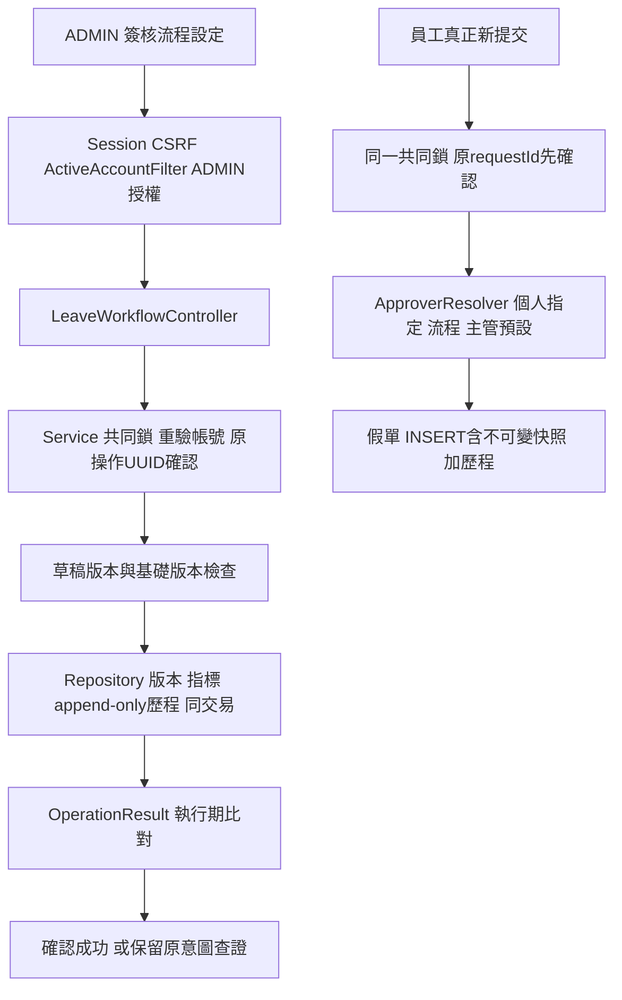

# T05.2 請假流程設定與版本：學習交接

## 三分鐘摘要

這批讓ADMIN管理請假單關卡流程：編輯草稿→預覽→填原因發布→只有之後的新提交使用它。個人指定優先於共用流程；沒有發布流程時保留原直屬主管預設。高優先來源失效會阻擋，不偷偷換人。ADMIN能改設定，仍不能審核別人指派給其他人的假單。

草稿、發布版本、提交快照是三件事。草稿可改、用rowVersion擋過期覆蓋；發布版本不可修改，單一指標指定目前版；提交快照保存當次來源／流程／一關／解析人及顯示資訊，不隨新流程或改名改變。既有待審只可由合法管理改派功能改派，原快照保留。舊列沒有新欄位就顯示舊制，不能從現在設定猜歷史。

原鍵重試先查既有資料，避免「送出成功但回應遺失」之後新版發布或原審核人停用，卻重新解析出另一人。設定儲存／發布也使用持久化UUID及完整操作結果；畫面不能只憑HTTP200就宣稱成功。未知時鎖原本文，查證或原鍵重試；404可能仍在處理中，不是確定沒發生。

本批沿用模組化單體與共同OrganizationLock，不做通用BPM、多關卡或設計器。所有業務寫入、快照、指標與歷程同交易；UI隱藏只是操作提示，真正授權在API與Service。真人操作步驟見[manual-verification](../renewflow/t05-2/manual-verification.md)，待Max實際執行。

## 操作入口與完整資料流



ADMIN導航`/#/admin/leave/workflow`，設定API`/api/admin/leave/workflow`；正式請假URL不變。管理員可預覽員工與已儲存草稿；預覽共用解析器但不保證之後提交成功。本人／合法管理入口完整詳情、審核入口REVIEW_HISTORY繼續依T05.1範圍，不因流程設定擴權。

## 實際程式定位

| 檔案／方法 | 責任 |
|---|---|
| leave/LeaveWorkflowDtos.java | Values、Version、Operation、History、Preview、SubmissionSnapshot契約 |
| LeaveWorkflowController.java | ADMIN API的HTTP邊界，交Service，不承擔規則 |
| LeaveWorkflowService.save／publish／operation／preview | 草稿與發布版本檢查、同鍵確認、資格、預覽及交易 |
| LeaveWorkflowRepository.create／save／publish／activate／append | 條件SQL、唯一操作、不可變結果與指標 |
| ApproverResolver.resolve／snapshot | 優先順序、資格、非本人、共用解析及必要顯示快照 |
| LeaveRequestService.submit／LeaveRevisionService.submit | 原鍵先確認，新提交才解析並同INSERT存快照 |
| LeaveViews.requests | 只將已授權request自身快照放入DTO，不取全局設定 |
| V10__leave_workflow_versions.sql | 新表、FK、單草稿、發布／提交不可變與append-only |
| frontend/src/pages/LeaveWorkflowPage.tsx | 版本、表單、發布差異、搜尋預覽、未知及競態 |
| frontend/src/api/leaveWorkflow.ts | API型別及checkWorkflowOperation比對原意圖 |
| LeaveDetailDialog／LeaveAdminPage | 原提交快照、舊制標示及個人指定優先順序文案 |

詳細API本文／錯誤碼：[api](../renewflow/t05-2/api.md)。比較基準e6397659df9628362774f2438c2cfa60db293825，交付實作SHA見共用交接／Git；以下都對應實際程式，沒有新增依賴套件。

## 核心規則與資料模型

版本表leave_workflow_version保存DRAFT或PUBLISHED、內容版號number與草稿rowVersion。唯一DRAFT索引保證最多一份共用草稿；leave_workflow_state只有id=1，current指向發布列；leave_workflow_history保存每次操作前後內容、前後發布ID、操作者快照／時間／原因、UUID與正規化本文。發布版與歷程UPDATE／DELETE由觸發器拒絕。

leave_request追加workflow_version_id及approval_snapshot，兩者可空以保留舊列。真正新提交必須保存快照；PERSONAL與DEFAULT_MANAGER沒有流程ID，WORKFLOW引用發布版。資料庫檢查／外鍵與不可變觸發器避免事後改原快照。submitted_approver保持原提交人，approver仍是目前合法指派，改派不混淆兩者。

發布核心：

```java
admin(actor); lock.acquireFor(actor);
var prior = replay(actor, body.requestId(), fingerprint);
if (prior != null) return prior;
```

在原操作確認後才檢查草稿狀態、rowVersion、basePublishedId與現在資格。否則原發布成功後重試會被「已不是草稿」拒絕，使用者無法確認原結果。個人提交也同理：先找同員工requestId並比完整提交內容，沒有才解析。不同UUID代表新意圖；同UUID不能換來源、目標或本文。

新提交的INSERT包含`workflow_version_id,approval_snapshot`，之後才追加SUBMITTED歷程，兩者同交易。沒有在另一個交易補快照，也沒有發布時更新舊假單。V10保留舊資料null，不把現在流程回填到過去。

## 並行、交易與取捨

固定鎖順序：OrganizationLock的交易級advisory鎖→重驗actor→流程／組織／請假列。既有組織管理、個人設定、請假版本／審核／改派都在此鎖內，新流程發布也加入相同順序，不新增逆向鎖。發布先取得鎖則下一提交看新版；提交先取得則保存完整舊版，不能混用新版人員與舊版名稱。員工停用／改角色／主管也依此序列處理。

草稿編輯除共同鎖外還檢查rowVersion，避免第二人等待後用舊表單覆蓋。發布同時檢查basePublishedId；DB部分唯一索引與單一current指標是額外防線。共同鎖易於審查但降低並行吞吐，大資料量／負載未驗證，未因此加入Redis或分散式引擎。

預覽為短交易、同鎖讀一致設定，沒有新增假單／歷程；它只是現在看到的結果。一般本人預計審核人提示也不是保證。已停用／不合資格／自審／無主管時，API明確阻擋並提示用合法管理設定／改派，不fallback到ADMIN。

## 結果不明與前端競態

`checkWorkflowOperation`核對UUID、action、目標ID、流程版號、rowVersion、基礎發布ID、完整values與發布原因／metadata。斷線、5xx、JSON壞掉、本文讀取失敗、UUID錯配／缺欄位都保留原WorkflowIntent。後續403／409不清除未知；GET查證404也不產生新的UUID。查證原結果成功才解除鎖。放棄追蹤必須警告，且不取消已完成的伺服器操作。

表單與操作保存在本頁記憶體；不宣稱跨瀏覽器保存，離開前要查證／記下UUID。busyRef同步擋連按，fieldset整組鎖住；設定／搜尋／預覽各有序號，舊GET晚到不能覆蓋新操作或選擇。重新查版本保留未存輸入，放棄輸入另有確認。發布後重設草稿預覽模式，避免卡在不存在的草稿。

## 驗證與查問題

真HTTP／PostgreSQL整合：LeaveWorkflowIntegrationTest及SchemaTest，包含優先、草稿／發布、並行、相同鍵、版本更動／停用後重試、修改／重送／CHANGE／ALL／PART、改派／R1、新快照與歷程回滾、V9→V10舊欄位。全套後端及原請假回歸重跑，實際數字與log以[verification](../renewflow/t05-2/verification.md)為準。

新E2E在自己新建的*_test庫跑真表單；損壞JSON、缺欄位、錯UUID、本文讀取失敗、403／500、查證404與延遲GET是明確受控故障，後端真寫入仍可查證。手機模擬不等於實機。四個針對性變異分別漏快照、發布改舊指派、跳過原提交確認、漏發布鎖；各對應斷言失敗，原碼還原後完整測試通過，不只驗測試數量。

遇到問題先記錄操作UUID、流程ID／number／rowVersion、原requestId、HTTP code及目前指派；查原操作／目前版／歷程。不要改UUID硬重送、SQL改狀態、刪庫、repair或clean開發庫。啟動埠占用表示已有服務，確認本專案PID或原視窗Ctrl+C後再啟，不動不明服務。

## 面試技術重點

- 設定權與審核權：角色只決定哪種操作，資料範圍仍需實際指派及巢狀DTO檢查。
- 發布版本與快照：不可變設定是規則，提交快照是當次解析結果；改主管或發布不能改過去。
- 樂觀版號與共同鎖：前者擋舊表單，後者維護跨列／跨模組規則；唯一索引仍是最後防線。
- 原鍵去重：解決回應遺失，不只防連按；先確認原結果，才做現在業務驗證。
- 交易與append-only：版本、指標、快照、歷程同進退；稽核保留，不提供刪改捷徑。
- 模組化單體取捨：依實際單關卡問題建立小模型，不先實作所有未授權流程。

## 一題練習（不附答案）

Alice送出請假時流程v1指派Bob，後端已提交但回應遺失；管理員發布v2改指派Erin，並停用Bob。請說明Alice原requestId重試、Alice建立全新提交、ADMIN查設定、Bob從舊歷史入口查詳情，各自應有什麼結果；再列出一個能同時抓出「先重解析」與「發布偷偷改派」的整合測試。
